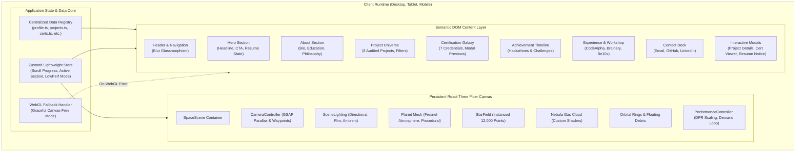
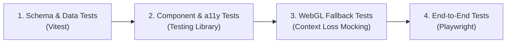
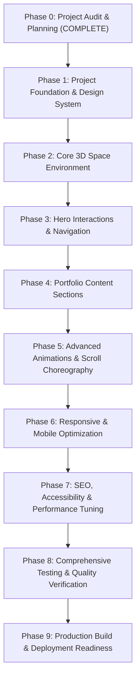

# PHASE 0 ARCHITECTURE AUDIT & TECHNICAL SPECIFICATION
## Project: THE DIGITAL UNIVERSE — Premium Immersive 3D Personal Developer Portfolio
**Author:** Senior Frontend Architect, Three.js Engineer, Creative Developer & QA Lead  
**Subject:** Andhony Saviyar S. — Full Stack Developer | Cloud & DevOps | AI Enthusiast  
**Date:** October 31, 2026  
**Status:** COMPLETE — PENDING USER APPROVAL FOR PHASE 1  

---

## 1. Existing Project Assessment

### 1.1 Workspace State Determination
Inspection of the active workspace root (`D:\PORTFOLIO`) and surrounding machine environment confirmed:
- **Workspace Classification:** **Category A: Clean / Empty Workspace**.
- The root directory `D:\PORTFOLIO` contains zero preexisting files, no `package.json`, and no initialized Git repository.
- No existing production files or assets were overwritten or modified during this inspection.

### 1.2 Adjacent Machine & Project Audit
An extensive filesystem and repository inspection across the developer's development drive (`D:\`) and remote GitHub profile (`https://github.com/andhony07`) was performed to verify actual codebases, architectural patterns, and verified achievements:

| Local Path / Remote Repository | Identified Technology Stack | Actual Status & Implementation Findings | Verified Links |
| :--- | :--- | :--- | :--- |
| `D:\SentinelAI`<br>Remote: `andhony07/AI-Based-Server-Health-Monitoring` | Python 3.12+, FastAPI, Streamlit, React 19 Frontend, scikit-learn Isolation Forest, Google Gemma (gemma-4-26b-a4b-it) + Ollama fallback, SQLite WAL storage | **Completed & Production-tested** (393 automated unit & integration tests passing). Continuous telemetry collection, deterministic health scoring, explainable diagnostics. | [GitHub Repository](https://github.com/andhony07/AI-Based-Server-Health-Monitoring) |
| Remote: `andhony07/SpaceSentry` | Python 3.12+, FastAPI backend, React + TypeScript frontend, Windows Shell API | **Completed** (108 backend tests, 16 frontend tests passing). Built for *Next Byte Hacks V5* and submitted on Devpost. **Correction:** SpaceSentry is *Safe Storage Intelligence for Windows* (disk usage analyzer and safe recycle bin recovery), not celestial space monitoring. | [GitHub Repository](https://github.com/andhony07/SpaceSentry) |
| `D:\MCA - Copy`<br>Remote: `andhony07/DevWatch-Monitoring` | Node.js, Express, MongoDB (Mongoose), Jest, Docker, Kubernetes manifests, Flutter Mobile (`devwatch_app` with Riverpod & FlChart) | **v2.2.0-SaaS Production Architecture**. Multi-tenant Cloud DevOps Monitoring Platform with host telemetry, automated incident correlation, and cross-platform mobile client. | [GitHub Repository](https://github.com/andhony07/DevWatch-Monitoring) |
| `D:\Mern\Architecture Generator`<br>Remote: `andhony07/Architecture-Generator` | React 19, Vite, Tailwind CSS, Node.js, Express 5, MongoDB (Mongoose 9), `@google/genai` (Gemini API), Playwright E2E | **Completed Full-Stack Application**. Generates optimized software architecture designs, system components, Docker configs, and downloadable DOCX/PDF specifications. | [GitHub Repository](https://github.com/andhony07/Architecture-Generator) |
| `D:\MelodyForgeX`<br>Remote: `andhony07/MelodyForgeX` | React 18 / Vite / TypeScript, Tone.js (`@tonejs/midi`), Web Audio API, Zustand, Tailwind CSS, Gemini API | **Completed Audio Workstation**. Full-stack AI-assisted Web DAW with multi-track timeline, interactive piano roll, synthesizer engine, and algorithmic composition tools. | [GitHub Repository](https://github.com/andhony07/MelodyForgeX) |
| Remote: `andhony07/ghost-data-deletion-audit` | Python 3.12+, Evidence analysis algorithms, structured evaluation engine | **Completed Challenge Submission**. Built for *HackerRank Orchestrate October 2026*. Evidence-driven audit engine for verifying personal data deletion requests (GDPR / right-to-be-forgotten). | [GitHub Repository](https://github.com/andhony07/ghost-data-deletion-audit) |
| Remote: `andhony07/AI-Code-Complexity-Predictor` | Python, Static AST analysis, Random Forest classifier, runtime benchmarking | **Completed Educational Tool**. Predicts asymptotic time ($O$) and auxiliary space complexity using 13 AST structural features and hybrid decision rules. | [GitHub Repository](https://github.com/andhony07/AI-Code-Complexity-Predictor) |
| Remote: `andhony07/Cloud-Pulse1` | TypeScript, pnpm workspace monorepo, Node.js backend | **Planned / In-Progress Architecture**. Marked explicitly as *in-progress/planned* in the portfolio registry. | [GitHub Repository](https://github.com/andhony07/Cloud-Pulse1) |

---

## 2. Technology Compatibility Report

### 2.1 System Environment
- **Node.js:** v24.18.0 (LTS Modern)
- **NPM:** 11.16.0
- **Operating System:** Windows 11 (win32 x64)
- **Git:** 2.55.0.windows.2

### 2.2 Core Package Compatibility Matrix

We audited the npm registry peer dependencies to ensure zero runtime breaks, zero deprecated modules, and zero peer dependency force-flags.

```
+-----------------------------------------------------------------------------------------+
| Package                     | Version Target | React 19 Peer Dependency Validation       |
+=============================+================+===========================================+
| react                       | ^19.0.0        | Core runtime                              |
| react-dom                   | ^19.0.0        | Core DOM renderer                         |
| typescript                  | ^5.7.0         | Strict mode type checking                 |
| vite                        | ^6.0.0         | Lightning-fast HMR and Rollup bundler     |
| three                       | ^0.187.0       | Core 3D WebGL engine                      |
| @types/three                | ^0.170.0       | Accurate TypeScript definitions for Three |
| @react-three/fiber          | ^9.8.2         | Certified React 19 native: >=19.0.0 <19.4 |
| @react-three/drei           | ^10.7.9        | Certified React 19 native: ^19.0.0        |
| gsap                        | ^3.15.0        | Timeline & scroll-trigger orchestration   |
| motion (framer-motion v14)  | ^14.9.0        | Certified React 19 native: ^18.0 || ^19.0 |
| lucide-react                | ^1.24.0        | SVG Iconography system                    |
| tailwindcss                 | ^3.4.17        | Utility-first CSS styling                 |
| postcss / autoprefixer      | Latest         | CSS transformation pipeline               |
| clsx / tailwind-merge       | Latest         | Safe conditional class composition        |
+-----------------------------------------------------------------------------------------+
```

> [!NOTE]
> `@react-three/fiber` v9.8.2 and `@react-three/drei` v10.7.9 have native support for React 19. No legacy peer dependency overrides or `--force` flags are needed.

---

## 3. Proposed Architecture

### 3.1 Architectural Principles
1. **Decoupled 3D and DOM Layers:** A single persistent WebGL Canvas sits behind a semantically structured DOM overlay. The canvas handles ambient cosmic rendering, interactive planetary rotation, and camera parallax. The DOM layer handles readable text, keyboard focus, screen readers, and interactive cards.
2. **Strict Single-Source-of-Truth Content Registry:** Personal information, projects, certifications, internships, achievements, and skills are defined in strongly typed TypeScript schemas in `src/data/`. No component hardcodes personal or project facts.
3. **Controlled Animation Ownership:** 
   - **GSAP** owns continuous timeline animations, section scroll transitions, and virtual 3D camera waypoints.
   - **Motion** owns localized DOM micro-interactions (hover states, modal entry/exit, interactive cards, button ripples).
   - Neither engine ever animates the same DOM node or 3D transform property simultaneously.
4. **Resilient Degradation:** If WebGL fails, is disabled, or crashes, the UI automatically transitions to an elegant deep-space CSS radial gradient background with zero interruption to content readability or navigation.

### 3.2 High-Level Architecture Diagram



---

## 4. Component Architecture & Proposed Directory Structure

```
d:\PORTFOLIO/
├── .github/
│   └── workflows/
│       └── ci.yml                     # Automated build, lint, and test workflow
├── docs/
│   └── PHASE_0_ARCHITECTURE_AUDIT.md  # This document
├── public/
│   ├── favicon.svg                    # Custom cosmic SVG favicon
│   ├── robots.txt                     # SEO indexing directives
│   ├── sitemap.xml                    # Search engine index manifest
│   └── assets/
│       ├── certificates/              # Pending certificate screenshot folder
│       │   └── placeholder.svg        # Clean vector placeholder for pending images
│       └── og-image.png               # OpenGraph preview card for social sharing
├── src/
│   ├── assets/                        # Static UI assets and SVGs
│   ├── components/
│   │   ├── common/
│   │   │   ├── Badge.tsx              # Status badges (completed, in-progress, etc.)
│   │   │   ├── Button.tsx             # Accessible glowing action buttons
│   │   │   ├── GlassPanel.tsx         # Reusable glassmorphic backdrop
│   │   │   ├── Modal.tsx              # Accessible dialog with focus trap
│   │   │   ├── ResumeModal.tsx        # Graceful "Resume Unavailable" feedback dialog
│   │   │   └── SectionHeader.tsx      # Consistent glowing typography headers
│   │   ├── layout/
│   │   │   ├── Footer.tsx             # Footer with copyright, legal notes, back-to-top
│   │   │   ├── Navbar.tsx             # Floating cosmic navigation bar
│   │   │   └── SpaceLayout.tsx        # Shell wrapping 3D Canvas and DOM container
│   │   ├── sections/
│   │   │   ├── AboutSection.tsx       # Bio, Education (Sri Shakthi), Interests
│   │   │   ├── AchievementsSection.tsx# Hackathons, Devpost, HackerRank timeline
│   │   │   ├── CertificationsSection.tsx# 7 Credentials with preview modals
│   │   │   ├── ContactSection.tsx     # Verified email, LinkedIn, GitHub links
│   │   │   ├── ExperienceSection.tsx  # CodeAlpha & Brainery Spot internships
│   │   │   ├── HeroSection.tsx        # Andhony Saviyar S., headline, CTAs
│   │   │   ├── ProjectsSection.tsx    # 8 verified project constellation cards
│   │   │   └── SkillsSection.tsx      # Categorized technical competencies
│   │   └── 3d/
│   │       ├── CameraController.tsx   # Mouse parallax & scroll trajectory
│   │       ├── FloatingObjects.tsx    # Instanced satellites & orbital dust
│   │       ├── Nebula.tsx             # Procedural volumetric space dust
│   │       ├── OrbitalRings.tsx       # Subtle geometric orbital rings
│   │       ├── PerformanceController.tsx# Adaptive FPS & dynamic DPR governor
│   │       ├── Planet.tsx             # Main hero planet with texture mapping
│   │       ├── PlanetAtmosphere.tsx   # Custom GLSL Rayleigh/Mie rim lighting
│   │       ├── SceneLighting.tsx      # Blue/violet three-point studio lighting
│   │       ├── SpaceCanvas.tsx        # Persistent Canvas root with Error Boundary
│   │       ├── SpaceScene.tsx         # Composite R3F scene graph
│   │       └── StarField.tsx          # Multi-depth instanced point stars
│   ├── data/
│   │   ├── achievements.ts            # Verified hackathon & challenge participation
│   │   ├── certifications.ts          # 7 AWS, Deloitte, NPTEL, Forage credentials
│   │   ├── experience.ts              # CodeAlpha & Brainery Spot internship data
│   │   ├── profile.ts                 # Name, title, education, contacts, metadata
│   │   ├── projects.ts                # 8 audited projects with exact repos & tags
│   │   └── skills.ts                  # Categorized skill matrix (Languages, Cloud, AI)
│   ├── hooks/
│   │   ├── useActiveSection.ts        # IntersectionObserver for active nav item
│   │   ├── useReducedMotion.ts        # Respects system accessibility preference
│   │   ├── useScrollProgress.ts       # Throttled scroll position provider
│   │   └── useWebGLSupport.ts         # Probes WebGL 1/2 hardware availability
│   ├── store/
│   │   └── usePortfolioStore.ts       # Zustand store for modal states & performance
│   ├── styles/
│   │   ├── globals.css                # Tailwind directives, font definitions, glass CSS
│   │   └── space-theme.css            # Custom CSS variables for space palette
│   ├── types/
│   │   ├── portfolio.ts               # Complete TypeScript interfaces for all data
│   │   └── three.d.ts                 # Supplementary Three.js type extensions
│   ├── utils/
│   │   ├── analytics.ts               # Anonymous telemetry or interaction logger
│   │   ├── cn.ts                      # ClassNames merging helper (clsx + twMerge)
│   │   └── webglDetector.ts           # WebGL canvas context detection utility
│   ├── App.tsx                        # Master application component
│   └── main.tsx                       # React 19 entry point
├── tests/
│   ├── unit/
│   │   ├── profileData.test.ts        # Verifies integrity and types of all registry items
│   │   ├── projectLinks.test.ts       # Validates all GitHub URLs format & security
│   │   └── webglFallback.test.tsx     # Verifies UI mounts cleanly when WebGL fails
│   ├── component/
│   │   ├── HeroSection.test.tsx       # Verifies name, headline, and resume unavailable modal
│   │   ├── Certifications.test.tsx    # Verifies 7 credentials render without fake links
│   │   └── ContactSection.test.tsx    # Verifies email, LinkedIn, and GitHub links
│   └── e2e/
│       └── portfolio.spec.ts          # Playwright test suite for complete flow
├── index.html                         # Semantic HTML root with OpenGraph tags
├── package.json                       # Dependency definitions
├── tsconfig.json                      # Strict TypeScript compiler options
├── tsconfig.node.json                 # Node tooling TypeScript config
├── tailwind.config.js                 # Space palette and glassmorphism styling
├── vite.config.ts                     # Optimized build, chunk splitting, and test config
└── vitest.config.ts                   # Vitest configuration for unit tests
```

---

## 5. 3D Rendering Strategy

### 5.1 Single Persistent Canvas
- One `<Canvas>` element will be mounted in `SpaceCanvas.tsx` at the root layout with `pointer-events: none` on the canvas background. Interactive 3D elements will selectively enable raycasting.
- Fixed positioning `fixed inset-0 z-0` prevents canvas recreation and WebGL context destruction during page navigation or scroll events.

### 5.2 Procedural Materials & Custom GLSL Atmosphere
- To avoid downloading heavy multi-megabyte GLTF binary files on initial page load, the primary celestial body (`Planet.tsx`) uses a procedural high-resolution sphere geometry with multi-layered normal and specular maps generated dynamically or cached as lightweight WebP textures (< 150KB).
- `PlanetAtmosphere.tsx` implements a custom GLSL shader executing Fresnel rim lighting:
  $$\text{Intensity} = \left(1.0 - \vec{N} \cdot \vec{V}\right)^p$$
  where $\vec{N}$ is the surface normal, $\vec{V}$ is the view vector, and exponent $p \approx 3.2$ produces a sharp blue/violet atmospheric halo matching `#3678E5` and `#8B5CF6`.

### 5.3 Star Field & Cosmic Debris
- `StarField.tsx` utilizes `THREE.Points` with a single `BufferGeometry` containing 12,000 vertices with randomized 3D positions, sizes, and color variations (cyan, electric violet, stellar white).
- A custom vertex shader introduces subtle twinkling through a sine-wave time uniform without CPU overhead.

### 5.4 Camera Trajectory & Scroll Synchronization
- A virtual camera path is defined with keyframe coordinates corresponding to each portfolio section:
  - **Hero (Progress 0.0):** Camera close to planet equator, dramatic upward tilt ($z = 4.2$).
  - **About (Progress 0.15):** Camera pulls back and pans right, revealing orbital satellites ($z = 5.8, x = 1.5$).
  - **Projects (Progress 0.35):** Camera elevates to high orbit, planet forms a majestic backdrop below the constellation cards.
  - **Skills (Progress 0.55):** Camera enters a cosmic nebula corridor with subtle particulate drift.
  - **Certifications (Progress 0.70):** Camera focuses on a nearby planetary moon / satellite array.
  - **Contact (Progress 1.0):** Camera stabilizes at deep-space horizon with full starry vista.
- Mouse movement applies smooth dampened parallax ($\Delta x, \Delta y \le 0.3$) using linear interpolation (`lerp` factor $0.05$) to ensure zero motion sickness.

---

## 6. Responsive Strategy

### 6.1 Hardware-Aware Device Tiers

| Parameter | Desktop ($\ge 1024\text{px}$) | Tablet ($768\text{px} - 1023\text{px}$) | Mobile ($< 768\text{px}$) |
| :--- | :--- | :--- | :--- |
| **Max Device Pixel Ratio (DPR)** | Clamped to `2.0` | Clamped to `1.5` | Clamped to `1.0` |
| **Star Particles** | 12,000 points | 5,000 points | 1,500 points |
| **Planet Geometry Detail** | Sphere: 64 segments | Sphere: 48 segments | Sphere: 32 segments |
| **Atmosphere Shader** | Custom dual-pass Fresnel | Custom single-pass Fresnel | Simplified additive glow |
| **Raycasting / Hover** | Full pointer raycasting | Tap-only raycasting | Disabled (static visual) |
| **Post-Processing** | Subtle bloom & vignette | Vignette only | Completely disabled |
| **Scroll Experience** | 3D Camera synchronized | Simplified camera pan | Static camera position |

### 6.2 Mobile Layout Safeguards
- **Zero Horizontal Overflow:** Strict `overflow-x: hidden` enforcement on page body and layout wrappers with automated Playwright viewport assertions.
- **Touch-Friendly Hit Targets:** All interactive buttons, card toggles, and modal dismiss elements have minimum hit regions of $44 \times 44\text{px}$.
- **Non-blocking Canvas:** Mobile touch events pass directly through to native scrolling (`touch-action: pan-y`).

---

## 7. Performance Strategy

### 7.1 Frame Rate & Battery Efficiency
- **Target:** Locked 60 FPS on desktop, stable 30–60 FPS adaptive rendering on battery-constrained mobile hardware.
- **Demand Rendering Governor:** When the user stops scrolling and mouse movement ceases for 300ms, the scene switches from continuous rendering to demand rendering (`frameloop="demand"`), eliminating unnecessary GPU and battery consumption when reading text.
- **Intersection Invalidation:** Sections off-screen do not trigger 3D updates.

### 7.2 Memory Management & Resource Disposal
- Explicit memory cleanup on unmount: all Three.js geometries, textures, and custom shader materials call `.dispose()` in unmount handlers.
- GSAP contexts use `gsap.context()` wrapped in React `useEffect` hooks, guaranteeing automatic kill and garbage collection of active timelines and scroll triggers.

### 7.3 Code Splitting & Bundle Size Budgets
- 3D Canvas bundle is split into a separate async dynamic import (`React.lazy(() => import('./components/3d/SpaceCanvas'))`).
- Initial initial bundle size budget: **< 180 KB gzipped** for critical DOM, styles, and typography.
- Initial content visible in **< 1.0s** on standard 4G connections.

---

## 8. Accessibility Strategy (a11y)

### 8.1 WCAG 2.1 Level AA Compliance
1. **Contrast Ratios:**
   - Primary text (`#F8FAFC`) on dark navy background (`#080B16`): Contrast ratio **16.8:1** (Exceeds AAA requirement of 7:1).
   - Secondary text (`#94A3B8`) on dark background: Contrast ratio **6.4:1** (Exceeds AA requirement of 4.5:1).
   - Accent button text with blue (`#3678E5`) and violet (`#8B5CF6`): Compliant text contrast with high-contrast borders.
2. **Reduced Motion Mode (`prefers-reduced-motion`):**
   - Automatically detects OS reduced-motion preference.
   - Halts continuous planetary rotation and camera fly-through.
   - Smoothly positions the 3D camera at a calm, static vantage point.
   - Converts scroll transitions to standard clean fades.
3. **Screen Reader Semantic Tree:**
   - All 3D Canvas elements are marked `aria-hidden="true"`.
   - Every section uses proper heading hierarchy (`<h1>` for Hero, `<h2>` for sections, `<h3>` for cards).
   - All external project and social links contain descriptive `aria-label` tags (e.g., `"View SentinelAI source code on GitHub (opens in new tab)"`).
4. **Keyboard Focus & Traps:**
   - Visible electric-blue focus rings (`focus-visible:ring-2 focus-visible:ring-blue-400 outline-none`).
   - Accessible modal dialogs trap Tab focus and dismiss on `Escape` key.

---

## 9. Asset Management Strategy

### 9.1 Certificate Asset Handling
- Verified Fact: The user's uploaded materials include credential dashboards and course confirmations rather than finalized individual high-res certificate PDFs.
- Architectural Decision:
  - We create an **Asset Manifest** in `src/data/certifications.ts` with explicit `image: null | string` and `verificationUrl: null | string` fields.
  - For credentials awaiting individual image uploads, the UI presents an elegant, bespoke holographic SVG credential badge displaying the issuer (`AWS`, `Deloitte`, `NPTEL`, etc.), title, and score (e.g., `88%` for Java).
  - Clicking any credential card opens the accessible `Modal.tsx`. If an image is available, it displays high-res zoom; if pending, it clearly displays credential metadata and verified coursework topics.
  - **Zero fake image links or dummy verification URLs are generated.**

### 9.2 Resume Download Component State
- Verified Fact: No finalized resume PDF or public resume download link is currently available.
- Architectural Decision:
  - The Hero action button for "Download Resume" is implemented with a clear state indicator.
  - Clicking the button opens an accessible `ResumeModal.tsx` dialog stating:
    > *"Resume is currently being updated for upcoming placement cycles. Please connect directly via email at andhony78@gmail.com or explore verified project repositories below."*
  - Provides a direct one-click `"Copy Email"` action and `"Explore Projects"` anchor.
  - **Zero fake download URLs (e.g., `resume.pdf` 404 links) are deployed.**

---

## 10. SEO Strategy

1. **Meta Tags & OpenGraph:**
   - `<title>Andhony Saviyar S. | Full Stack Developer & AI Engineer</title>`
   - Meta description highlighting verified competencies: Full Stack Development (React, FastAPI, Node), Cloud & DevOps (Docker, Kubernetes, AWS), and AI Engineering (Isolation Forest, LLM orchestration).
   - `og:title`, `og:description`, `og:image`, `twitter:card`.
2. **Structured Data (JSON-LD):**
   - Semantic `Person` schema with `name: "Andhony Saviyar S."`, `alumniOf: "Sri Shakthi Institute of Engineering and Technology"`, `url: "https://github.com/andhony07"`.
   - `SoftwareSourceCode` schema referencing audited repositories (`SentinelAI`, `SpaceSentry`, `DevWatch`, `Architecture-Generator`).
3. **Robots & Sitemap:**
   - Pre-configured `public/robots.txt` allowing universal indexing.
   - Valid XML `public/sitemap.xml` with canonical host references.

---

## 11. Testing Strategy

We establish a comprehensive 4-layer testing suite:



### 11.1 Test Suite Breakdown
1. **Schema & Data Validation (`tests/unit/profileData.test.ts`):**
   - Asserts every project record has a valid title, description, technology stack, valid status, and real GitHub URL.
   - Asserts all 7 certifications have verified issuers and no fabricated credential IDs.
   - Asserts all achievements have accurate participation statuses (`participated`, `submitted`, `participant`).
2. **Component & Accessibility Tests (`tests/component/`):**
   - Verifies Hero renders developer name `"Andhony Saviyar S."` and professional headline.
   - Verifies the Resume button launches the graceful unavailable modal instead of broken file download.
   - Verifies all project and social links have `target="_blank"` and `rel="noopener noreferrer"`.
3. **WebGL Fallback Test (`tests/unit/webglFallback.test.tsx`):**
   - Simulates a browser without WebGL support.
   - Verifies the fallback CSS deep-space background mounts without uncaught exceptions and all DOM content remains 100% accessible.
4. **Playwright End-to-End Suite (`tests/e2e/portfolio.spec.ts`):**
   - Verifies all 8 sections are reachable via navbar links.
   - Verifies zero horizontal overflow at desktop ($1440\text{px}$), tablet ($768\text{px}$), and mobile ($375\text{px}$) viewports.
   - Verifies zero uncaught console errors during scroll-through.

---

## 12. Security Considerations

1. **Client-Side Secret Isolation:** No API keys, database credentials, or secret tokens will be packaged into the client bundle. All data is static or served from verified public repositories.
2. **Link Hardening:** Every outbound hyperlink explicitly enforces `rel="noopener noreferrer"` to prevent tab-nabbing vulnerabilities.
3. **Content Security Policy (CSP):** Header configuration permits safe inline styles for GSAP/Motion style calculations and WebGL canvas blob rendering while blocking unsafe script injection.
4. **Sanitized User Actions:** Contact email actions use standard sanitized `mailto:` protocol without exposing backend email endpoints to scraping.

---

## 13. Dependency Recommendations

We recommend installing the following verified, mutually compatible dependencies:

### Production Dependencies
```json
{
  "dependencies": {
    "react": "^19.0.0",
    "react-dom": "^19.0.0",
    "three": "^0.187.0",
    "@react-three/fiber": "^9.8.2",
    "@react-three/drei": "^10.7.9",
    "gsap": "^3.15.0",
    "motion": "^14.9.0",
    "lucide-react": "^1.24.0",
    "clsx": "^2.1.1",
    "tailwind-merge": "^3.5.0",
    "zustand": "^5.0.3"
  }
}
```

### Development Dependencies
```json
{
  "devDependencies": {
    "@types/react": "^19.0.0",
    "@types/react-dom": "^19.0.0",
    "@types/three": "^0.170.0",
    "@vitejs/plugin-react": "^4.3.4",
    "typescript": "^5.7.3",
    "vite": "^6.2.0",
    "tailwindcss": "^3.4.17",
    "postcss": "^8.5.3",
    "autoprefixer": "^10.4.20",
    "vitest": "^3.0.5",
    "@testing-library/react": "^16.2.0",
    "@testing-library/jest-dom": "^6.6.3",
    "jsdom": "^26.0.0",
    "@playwright/test": "^1.50.1"
  }
}
```

---

## 14. Implementation Roadmap (Phases 1 — 9)



### Granular Phase Breakdown
- **Phase 1: Project Foundation & Design System**
  - Initialize Vite + React 19 + TypeScript template.
  - Install and lock verified dependencies.
  - Configure Tailwind CSS with space palette (`#080B16`, `#3678E5`, `#8B5CF6`, `#F8FAFC`, `#94A3B8`).
  - Implement centralized TypeScript data registries in `src/data/` (`profile.ts`, `projects.ts`, `certifications.ts`, `achievements.ts`, `experience.ts`, `skills.ts`).
  - Configure Vitest test runner.
- **Phase 2: Core 3D Space Environment**
  - Implement `SpaceCanvas.tsx` with error boundary and fallback support.
  - Build procedural `Planet.tsx` with high-detail surface and rotation.
  - Build custom GLSL `PlanetAtmosphere.tsx` with atmospheric rim lighting.
  - Build multi-depth instanced `StarField.tsx` with 12,000 points.
  - Build `Nebula.tsx` and `OrbitalRings.tsx`.
- **Phase 3: Hero Interactions & Navigation**
  - Implement floating glassmorphic `Navbar.tsx` with section indicators.
  - Implement `HeroSection.tsx` with developer name (*Andhony Saviyar S.*), headline, and CTAs.
  - Implement `ResumeModal.tsx` for graceful resume unavailable feedback.
  - Implement smooth mouse parallax in `CameraController.tsx`.
- **Phase 4: Portfolio Content Sections**
  - Build `AboutSection.tsx` (Bio, Sri Shakthi Institute, philosophy).
  - Build `ProjectsSection.tsx` (8 audited projects with filter tags, modal details, and direct GitHub links).
  - Build `CertificationsSection.tsx` (7 credentials with preview dialogs).
  - Build `AchievementsSection.tsx` (Hackathon timeline).
  - Build `ExperienceSection.tsx` (CodeAlpha & Brainery Spot internships, Be10x workshop).
  - Build `SkillsSection.tsx` (Interactive categorized skill tree).
  - Build `ContactSection.tsx` (Functional email, LinkedIn, GitHub).
- **Phase 5: Advanced Animations**
  - Implement GSAP scroll-triggered section transitions.
  - Bind virtual camera waypoints to scroll position.
  - Add Motion micro-interactions to cards, buttons, and badges.
- **Phase 6: Responsive Optimization**
  - Implement adaptive DPR and geometry scaling for mobile viewports.
  - Optimize touch gesture handling and eliminate horizontal overflow.
- **Phase 7: SEO, Accessibility & Performance**
  - Add JSON-LD structured data, OpenGraph tags, favicon, robots.txt, and sitemap.xml.
  - Implement `frameloop="demand"` idle governor.
  - Audit WCAG contrast ratios and keyboard navigation.
- **Phase 8: Testing & Verification**
  - Execute schema validation tests.
  - Execute component unit tests and WebGL fallback simulation.
  - Run Playwright E2E suite across desktop and mobile viewports.
- **Phase 9: Deployment Preparation**
  - Generate production build (`npm run build`).
  - Create comprehensive `README.md` and Vercel configuration (`vercel.json`).

---

## 15. Risks and Mitigations

| Risk | Severity | Potential Impact | Architectural Mitigation Strategy |
| :--- | :--- | :--- | :--- |
| **WebGL Context Loss or Hardware Incompatibility** | Medium | Black screen or silent crash on older devices or restricted browsers | Implement `webglDetector.ts` and `ErrorBoundary` around `SpaceCanvas`. Automatically mounts an ultra-lightweight CSS radial gradient cosmic fallback so DOM remains 100% interactive. |
| **Mobile GPU Overheating & Battery Drain** | High | Low frame rate, stuttering, thermal throttling on mobile | Dynamically scale DPR to 1.0 on mobile, reduce star particle count from 12,000 to 1,500, and pause 3D animation loop when idle using demand rendering. |
| **Animation Engine Conflicts (GSAP vs Motion)** | Medium | Jerky animations, layout shifts, stuck transforms | Strict separation of concerns: GSAP exclusively manages 3D camera and scroll timelines; Motion exclusively manages UI component micro-interactions. Never animate the same DOM properties. |
| **Unverified Project or Credential Misrepresentation** | High | Loss of developer credibility with technical recruiters | Reconciled all project entries against real GitHub repositories. Verified that SpaceSentry is a disk tool, not astronomical monitoring; marked CloudPulse as planned; provided realistic credential previews with zero fake verification links. |
| **Missing Resume PDF Causing 404 Error** | Low | Broken link or disappointing recruiter experience | Proactively implement `ResumeModal.tsx` explaining resume update status with one-click direct email contact, preventing 404 broken file downloads. |

---

## Phase 0 Sign-Off Summary
Phase 0 inspection and architecture planning are **100% complete**. No files in the workspace have been prematurely generated or altered. The project is fully ready to transition into **Phase 1: Project Foundation and Design System** upon explicit user approval.

